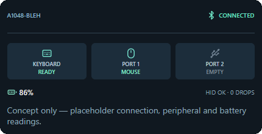
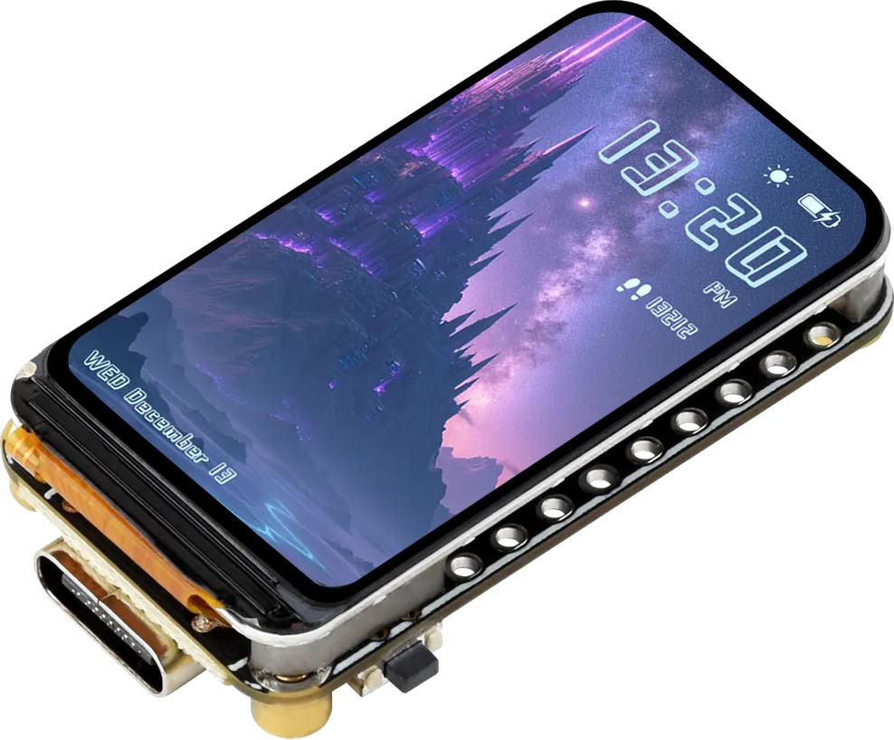
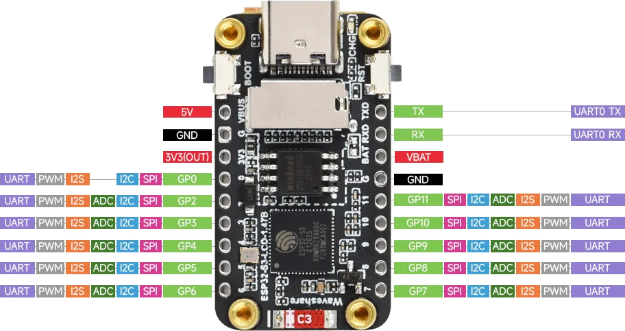
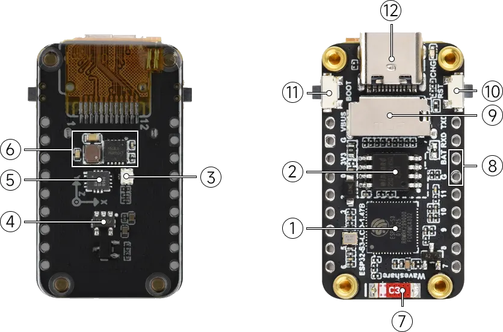

# A1048-BLEH

**An Apple A1048 USB keyboard, rebuilt as a battery-powered Bluetooth LE keyboard without discarding its original Mitsumi controller or two-port USB hub.**

Apple A1048 · Mitsumi PCB **820-1495-A** · Waveshare **ESP32-S3-LCD-1.47B**

<p align="center">
  
</p>

> **Status: Concept / hardware investigation.** The architecture described below is the design target, not a claim that the finished wireless keyboard or hub bridge is already working.

## The idea

The 2003 Apple A1048 has everything worth keeping: its original typing feel, full-size layout, Mitsumi keyboard electronics, and two USB-A ports. A1048-BLEH aims to preserve those features while removing the permanent upstream USB cable.

A **Waveshare ESP32-S3-LCD-1.47B** will host the A1048's existing USB hub, read the built-in keyboard and supported devices connected to its two external ports, then translate their input to **Bluetooth LE HID**. A compact color status screen will occupy the otherwise unused user-facing surface **above the arrow keys**.

The intended result is a keyboard that looks at home alongside a 2010–2013-era **27-inch iMac**, but behaves as a modern wireless peripheral.

<!-- TODO: Add finished-keyboard concept render here. Suggested path: images/A1048-BLEH_complete_concept.png -->

## What stays original

- The Apple A1048 case, key layout, and keyboard matrix/controller.
- The Mitsumi USB hub and **both downstream USB-A receptacles**.
- The original keyboard's USB identity and behavior on the *internal wired side*, as far as the hardware permits.

The ESP32 does **not** scan the key matrix directly, replace the Mitsumi controller, or attempt to tunnel arbitrary USB traffic over BLE. It acts as a local USB host and translates supported USB HID functions into a wireless HID device.

## Proposed architecture

```text
                  Apple A1048 / Mitsumi 820-1495-A
           ┌─────────────────────────────────────────┐
           │           Original USB hub              │
           │    ┌─────────┼──────────┐               │
           │ Keyboard   USB-A #1   USB-A #2           │
           └──────────────┬──────────────────────────┘
                          │ upstream USB 1.1
                          ▼
                ESP32-S3 native USB host
                          │
              Device discovery + HID parsing
                          │
            Keyboard / mouse / consumer controls
                          │
                BLE HID report aggregation
                          │
                          ▼
                One BLE HID peripheral
                     Mac / PC / etc.
```

**One wired hub, potentially several USB devices, one BLE peripheral.** The first supported functions will be the original keyboard and a conventional USB mouse. Additional keyboards/keypads and consumer-control devices are targets for later work. Unsupported USB classes will not magically become wireless USB devices.

### USB-A port philosophy

The two original ports are functional goals, not decorative relics. A1048-BLEH should enumerate the hub and discover connected devices, then selectively bridge supported HID interfaces. Each physical device retains its own internal state; keyboard inputs may be merged, while a mouse gets its own BLE HID report.

Actual simultaneous device capacity depends on the ESP32-S3 USB-host channel budget and the attached devices' endpoint descriptors. **Three active downstream functions have not yet been validated on this board.**

## The visible modification: 1.47-inch LCD

The **172 × 320 ST7789 IPS display** will be mounted in landscape orientation above the arrow cluster, providing a **320 × 172** status area.

The default screen is planned to show:

- BLE advertising, pairing, and connection status.
- Built-in A1048 keyboard ready/error state.
- Detection and supported function of each USB-A port.
- Battery status, when a verified measurement source is available.
- USB power faults, unsupported interfaces, and report-delivery errors.

A separate diagnostic view can retain details from the existing USB-to-BLE keyboard adapter, including key usage, modifiers, and dropped reports. The LCD is for status; keyboard operation must continue even if the display fails.

## Host hardware

**[Waveshare ESP32-S3-LCD-1.47B](https://docs.waveshare.com/ESP32-S3-LCD-1.47B)**

- ESP32-S3R8 dual-core processor, up to 240 MHz.
- 16 MB Flash / 8 MB PSRAM.
- 1.47-inch ST7789 IPS LCD, 172 × 320 pixels.
- Bluetooth LE 5-capable radio.
- Native USB OTG peripheral/controller, used here in **host mode**.
- Onboard lithium battery charging/management circuitry and battery connector.
- QMI8658 six-axis IMU, microSD slot, onboard RGB LED, BOOT and RESET controls.

<p align="center">
  
</p>

<p align="center">
  
</p>

<p align="center">
  
</p>

<details>
<summary>Waveshare's numbered board features</summary>

1. ESP32-S3R8 dual-core processor, up to 240 MHz.
2. 16 MB Flash.
3. RGB LED and light-diffusing acrylic.
4. ME6217C33M5G LDO; specified maximum output current of 800 mA (not a USB-hub current budget).
5. QMI8658 six-axis gyroscope/accelerometer.
6. Charging management circuit.
7. Onboard ceramic antenna.
8. 3.7 V lithium-battery connector and charging/discharging support.
9. TF/microSD card slot.
10. RESET button.
11. BOOT button.
12. USB Type-C for board power, USB communication, and firmware download.

</details>

## External USB-C connection

The A1048's removed upstream cable leaves an attractive original exit location. The design goal is to install a **USB-C receptacle at that opening**, rather than leave a dangling cable.

<!-- TODO: Add USB-C-in-original-cable-opening render here. Suggested path: images/A1048-BLEH_usb-c_exit.png -->

**This connector's exact role is not yet finalized.** The likely use is power/charging and development access. It should *not* be assumed to provide transparent wired USB access to the original hub: the ESP32-S3 has a single native USB OTG controller and cannot serve as the hub's USB host and a normal USB device on that same controller simultaneously. A true wired fallback would require an explicit switching/bypass design.

The original hub also requires an appropriately switched and current-limited **5 V VBUS supply**. Battery charging, hub power, and USB-C power/data routing must be designed together, with protection against backfeeding.

## Firmware foundation

A1048-BLEH is a variant of the existing **ESP32 USB-to-BLE Keyboard Adapter**, not a from-scratch keyboard firmware effort.

| Existing component | Intended A1048-BLEH work |
| --- | --- |
| USB keyboard interface/policy | Hub-aware enumeration; support multiple HID interfaces |
| `keyboard_report` | Keep normalized boot-keyboard reporting initially |
| `bridge_core` / `bridge` | Per-device state, aggregate keyboard inputs, handle disconnections |
| `hid_service` | Expand BLE report map for mouse and consumer controls |
| `ble_keyboard` / `hid_delivery` | Preserve pairing, security and report-delivery safeguards |
| `bond_store` | Retain bonded-host state and update subscriptions as needed |
| `display` / `display_text` | Port ST7789 driver to Waveshare pins and landscape dashboard |
| `board` / power monitor | Replace old GPIO assignments and validate the new power hardware |

The first firmware milestone is intentionally modest: **make the original A1048 keyboard work through its own Mitsumi USB hub over BLE, with the new display reporting its state**. External USB-A peripherals come after that baseline is stable.

## Development milestones

- [ ] Photograph, identify, and trace the actual Mitsumi 820-1495-A PCB; verify upstream USB pads.
- [ ] Record hub and keyboard USB descriptors and Apple-specific HID usages.
- [ ] Check display-board fit, shield clearance, antenna placement, and battery space.
- [ ] Bring up the Waveshare display in landscape orientation.
- [ ] Enumerate the original A1048 hub and built-in keyboard with ESP32-S3 USB host.
- [ ] Bridge the built-in keyboard over BLE, including correct press/release behavior.
- [ ] Add keyboard LED-output handling and Apple-specific keys where supported.
- [ ] Detect and bridge a mouse on either external USB-A port.
- [ ] Support multi-keyboard/keypad input aggregation and appropriate rollover handling.
- [ ] Complete protected hub VBUS, battery, and USB-C routing.
- [ ] Validate host compatibility, reconnection, sleep/resume and long-running stability.
- [ ] Complete mechanical integration and enclosure finishing.

## The intended desk setup

A restored translucent-white A1048 with its small integrated display, sitting in front of a **27-inch aluminum iMac (circa 2010–2013)**. No permanently attached USB cable; the two original USB-A ports remain usable for supported HID accessories.

<!-- TODO: Add finished keyboard powered on beside 27-inch iMac render here. Suggested path: images/A1048-BLEH_imac_desk.png -->

## Engineering boundaries

- **USB host, not general-purpose wireless USB.** HID translation is the objective; storage, audio, and arbitrary USB classes are outside the initial scope.
- **Original hardware retained.** We do not need to reverse-engineer the matrix to build the first prototype.
- **One BLE HID device.** Different input types may be presented as separate reports under one pairing.
- **No unverified power claims.** The hub's current limits, port protection, 5 V conversion, and battery runtime require measurement.
- **Fail safely.** An LCD error should not stop typing. An overcurrent or USB power-path fault should disable the affected supply rather than keep retrying blindly.

## References

- [Waveshare ESP32-S3-LCD-1.47B documentation](https://docs.waveshare.com/ESP32-S3-LCD-1.47B)
- [Espressif ESP-IDF USB Host Library](https://docs.espressif.com/projects/esp-idf/en/stable/esp32s3/api-reference/peripherals/usb_host.html)
- [Espressif ESP-IDF USB Host Hub Driver](https://docs.espressif.com/projects/esp-idf/en/stable/esp32s3/api-reference/peripherals/usb_host.html)

---

**A1048-BLEH** Keep the keyboard. Keep the hub. Lose the cable.
